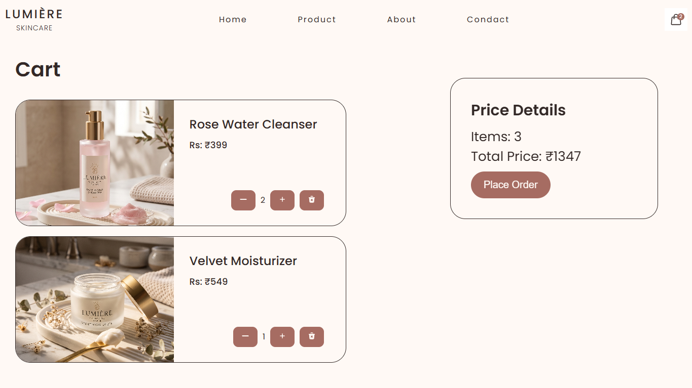

# ✨ LUMIÈRE – Your Skin, Your Glow

A modern and responsive skincare e-commerce web application built with **React.js**. Lumière provides a clean shopping experience where users can explore skincare products, view product details, manage their shopping cart, and simulate placing an order.

## 🌸 Project Overview

LUMIÈRE is a skincare shopping website designed with a focus on simplicity, elegance, and user experience.

The application allows users to browse skincare products, view individual product information, adjust quantities, and manage their shopping cart.

## 🚀 Features

- **Responsive UI** – Clean and modern interface for different screen sizes.
- **Product Listing** – Browse available skincare products.
- **Product Details** – View product images, descriptions, ratings, and prices.
- **Shopping Cart** – Add and remove products from the cart.
- **Quantity Management** – Increase or decrease product quantities.
- **Cart Summary** – Automatically calculate total items and prices.
- **Simulated Checkout** – Place an order and receive a success notification.
- **Toast Notifications** – User feedback using React Hot Toast.
- **Navigation** – Navigate between different pages using React Router.

## 🛠️ Technologies Used

| Technology | Purpose |
|---|---|
| React.js | Frontend development |
| JavaScript | Application logic |
| CSS3 | Styling and responsive design |
| React Router DOM | Page navigation |
| Axios | API requests |
| Context API | Global cart state management |
| JSON Server | Mock REST API |
| React Icons | Icons |
| React Hot Toast | Notifications |
| Vite | Development and build tool |

## 📂 Project Structure

```text
Lumiere/
│
├── public/
├── data/
│   └── product.json
│
├── src/
│   ├── assets/
│   ├── components/
│   │   ├── Cart.jsx
│   │   ├── CartItems.jsx
│   │   ├── Cartcontext.jsx
│   │   ├── Hero.jsx
│   │   ├── Items.jsx
│   │   ├── NavBar.jsx
│   │   └── ViewProduct.jsx
│   │
│   ├── pages/
│   │   ├── Home.jsx
│   │   ├── Product.jsx
│   │   ├── About.jsx
│   │   ├── Condect.jsx
│   │   └── NotFount.jsx
│   │
│   ├── App.jsx
│   └── main.jsx
│
├── package.json
└── README.md
```

## ⚙️ Installation and Setup

Follow these steps to run the project locally.

**1. Clone the repository**

```bash
git clone YOUR_GITHUB_REPOSITORY_URL
```

**2. Navigate to the project folder**

```bash
cd Lumiere
```

**3. Install dependencies**

```bash
npm install
```

**4. Start the application and JSON Server**

```bash
npm run dev
```

Make sure your `package.json` has scripts configured to start both Vite and JSON Server using `concurrently`.

## 🌐 Local Development URLs

| Service | URL |
|---|---|
| React Application | http://localhost:5173 |
| JSON Server API | http://localhost:4000/product |

## 🛍️ Application Pages

- `/` – Home page
- `/product` – Product listing page
- `/product/:id` – Individual product details
- `/cart` – Shopping cart

## 📸 Screenshots

Add your project screenshots here after uploading them to your GitHub repository.

For example:

```markdown



```

## 🔮 Future Improvements

- Implement product search and advanced filtering.
- Add user authentication and profile management.
- Integrate a real payment gateway.
- Add order history and tracking.
- Improve product recommendations.

## 👨‍💻 Developer

**Anie Jerson**

Frontend Developer | React.js Enthusiast

GitHub: [Anie-Jerson05](https://github.com/Anie-Jerson05)

---

⭐ If you like this project, consider giving it a star!

**LUMIÈRE – Your Skin. Your Glow.**